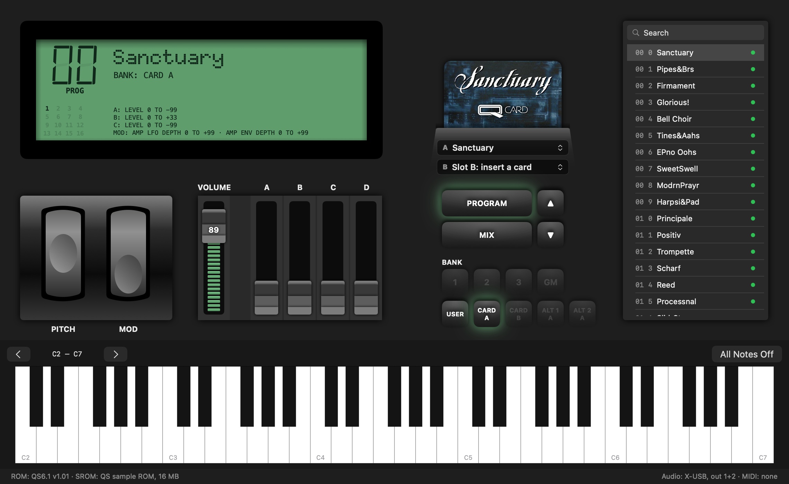
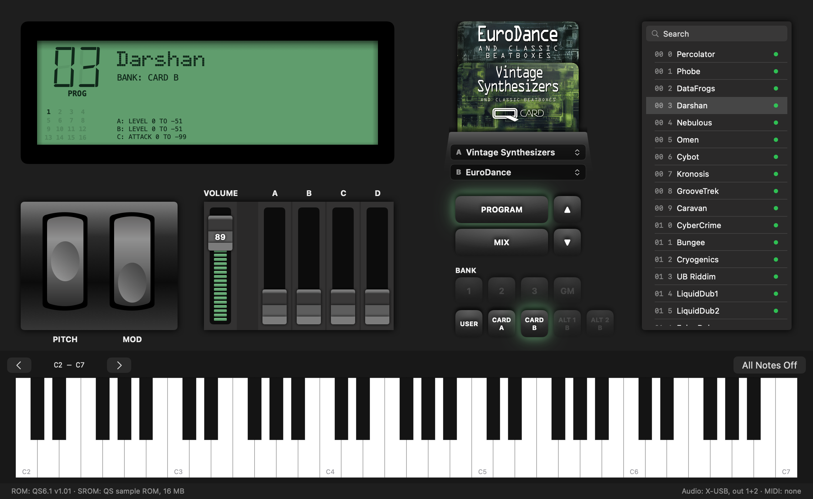
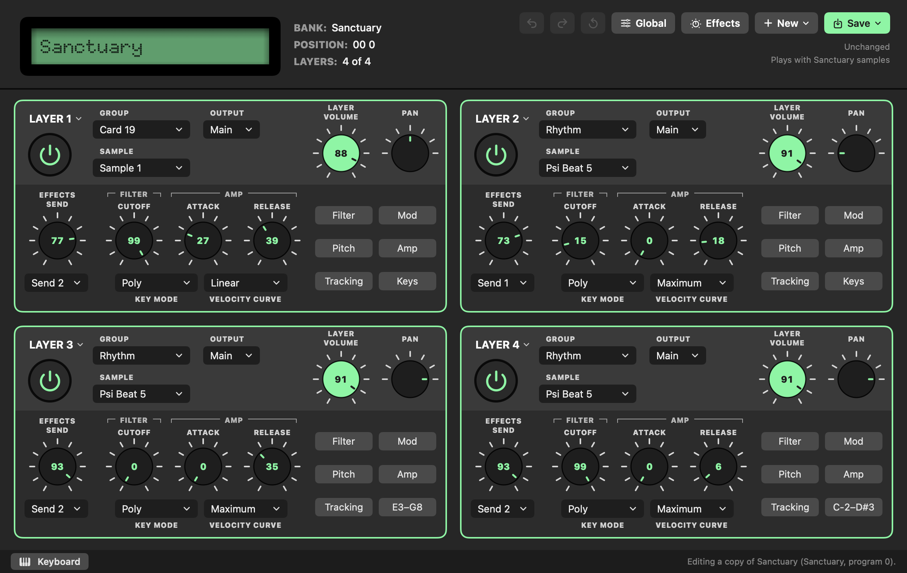
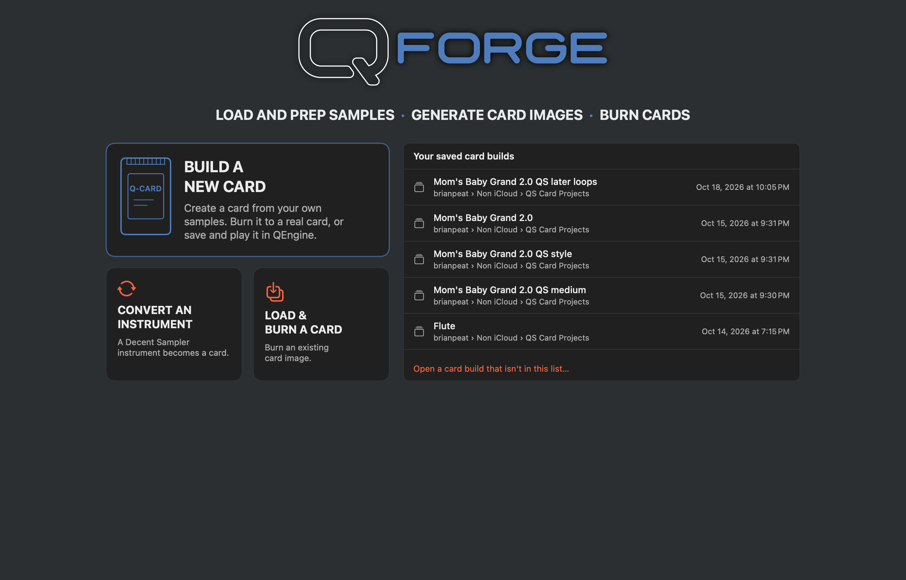
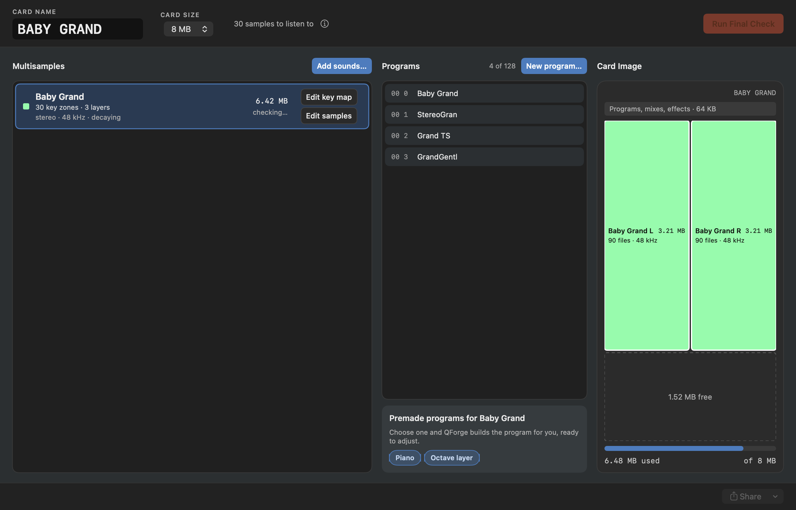
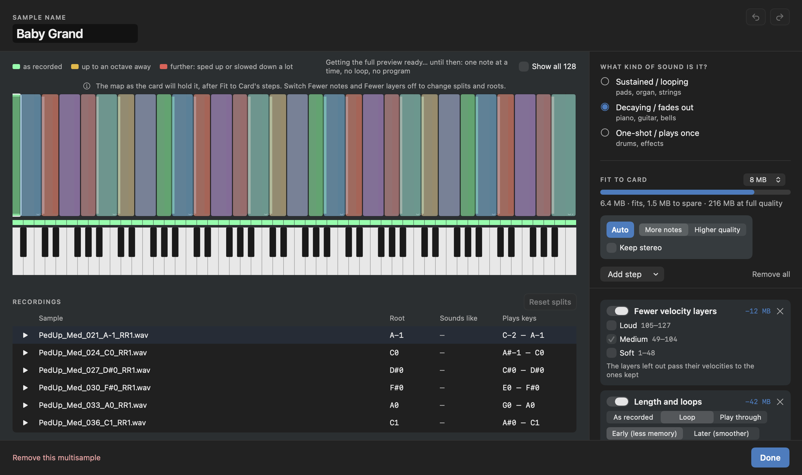
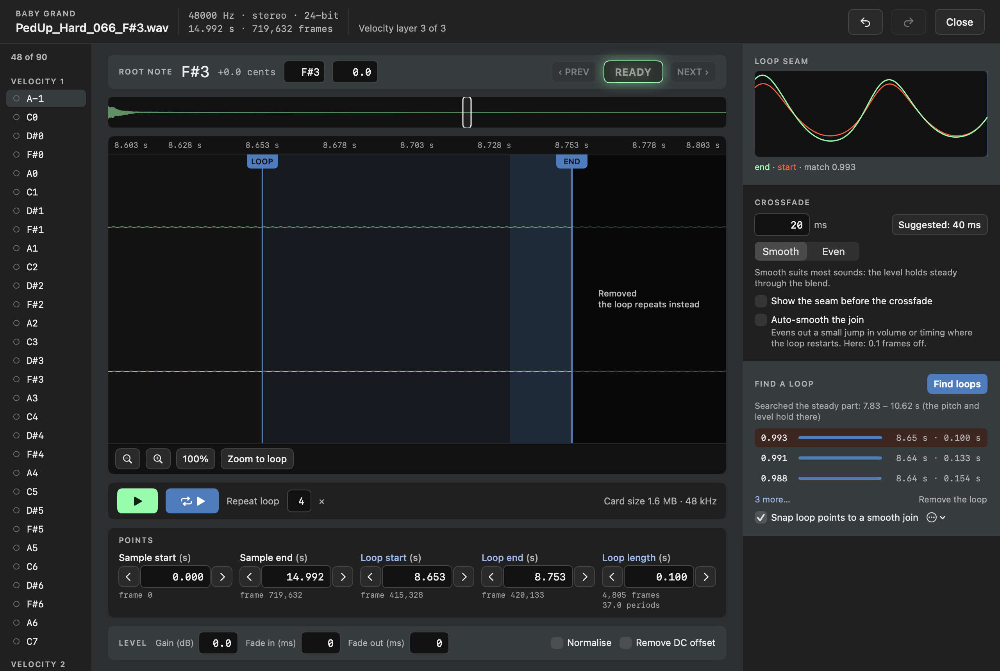

# Project Q

A labor of love for the Alesis QS series and QuadraSynth keyboards and racks.

## The Beginning

This started years ago actually, when I bought a QS 6 at auction. I flipped it quickly but realized that I missed it terribly. I found a QS 8.1 locally with a broken key pivot for cheap and picked it up. I just happened to have a spare pivot from fixing another controller and it worked great. Then my curiosity got the better of me. Card slots? Hmm... So I dug. I bought a RAM card from a friend, then I found a decently priced 8 meg AMD card on eBay. And... I should have known it would be a rabbit hole I'd never get fully out of.

## Trying to use the old tools

After finding as many free patches for the QS as I could online, I looked at card burning. I had no old computers, so I ended up learning I could burn IN the 8.1, but I needed the old apps. Okay, emulation it is. I ran every vintage Mac emulator I could find. I ran CrossOver, I ran UTM, I ran Parallels, I even ran Boot Camp on an older MacBook Air with Windows 7. I found copies of all the old apps. And I worked and worked until I did finally make an instrument, and I did finally burn a card. And it was... terrible. I tried to make a serial adapter; that never worked. MIDI to the 8.1 would sometimes fail. I finally just gave up and put it in storage.

## Enter Claude Code

I know, I know. People hate AI. But seriously, the day I realized I could just ask it to make something, or read something, or make two things work together, that was when I knew I could finally do something cool and then give it to other people. And that's how this was born. I wanted to not only make a software emulator for the QS series, I wanted to make MODERN tools anyone could use to create instruments and burn cards. So yes, these apps have been coded with Claude Code. All the research and digging into file formats and firmware has been done by Claude Code... but the apps came from my mind. I honed the workflows, I rearranged the layouts if they just weren't right. If you hate them, that's on me. I pushed and pushed until the workflow made sense to me and the interface felt right. This wasn't a one-day "Hey Claude, make me an app," and this also isn't an "I built this." I give credit where it is due.

## The Apps

The apps are not released yet. This repository will collect the research and documentation behind them as it is written up, and the apps
will be released when they are ready.

- **QEngine**
  This is the player. It emulates the hardware of a QuadraSynth or QS model, and it works pretty well. It won't come with card
  images, sample ROM or firmware ROM files, but it can load them. The goal is to emulate everything, though instead of forcing you to program from a copy of the actual front panel of your hardware, it has a well-organized edit screen and a full library and patch manager. It can be used as a software instrument, as an editor and patch manager for your hardware, or both. The feature list is pretty extensive, and the plan is to run it on Mac, Windows, possibly Linux, and iPad. The macOS and iPadOS versions are nearly finished.

*QEngine: one card, two cards stacked, and the program editor. Click an image to see it full size.*

- **QForge**
  This is the missing piece I have been wanting for years. It can open card images and burn them to your hardware. It can open
  sample files and let you build fully working instruments from them. It has a full sample and loop editor and a key map editor, and it even comes with tools that will shrink your files to make sure they fit on the card. It can save images for use in QEngine or let you burn them. It can even convert instruments from other sample formats and put them on a card. The goal is to make it as easy as possible for anyone to make their own cards from scratch.

*QForge: the start page, the main window, the key map with Fit to Card, and the sample editor.*

## How you can help us now: the MIDI test

If you own a QS or QuadraSynth, keyboard or rack, a short test in your browser reads information over MIDI and, when you press Send, saves the results to my server (so if you're curious and you dig and see peatcreative.com in there, that's my server). I will feed that data into Claude Code, and it will work to make sure the apps emulate more and more hardware. No, it's not pulling your ROM files, and it only reads your own patches if you tick the "Your own sounds" test. So to be clear, it only reads: nothing is written to your unit. It will switch screens and programs, but not write anything.

**[Open the QS MIDI Test](https://brianpeat.github.io/project-q/midi-test/)** (Chrome or Edge, with your MIDI interface connected both ways).

## Deep documentation is coming

Do you want to mess with this data and make your own projects? Go to it. Everything that can be documented will be, and it will be posted. This isn't a private thing I won't share; I want it all out there. And by all means, if you have data, share it with us!

Here are a few things that are coming:

- How a QS sound card is laid out, and how cards are burned over MIDI
- The keyboard's sysex: reading and writing programs, mixes, effects and global settings
- How the voice engine behaves, measured from the firmware: envelopes, detune, pitch, filters, levels
- How the effects chip works
- Loop finding for sampled instruments

## Not affiliated

Project Q is an independent project. Alesis, QS and QuadraSynth are trademarks of their owners, used here only to say what the tools work
with. Project Q does not include or distribute Alesis's sample ROMs, firmware or factory sounds.

Project Q is also not connected in any way to [ProjectQ](https://github.com/ProjectQ-Framework/ProjectQ), the open-source quantum
computing framework; the names are only similar.
